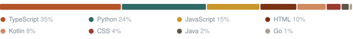

# Saathvik Kalepu

<!--HEADLINE-->
Software Engineer · Distributed Systems · Backend · Applied AI · Hyderabad, India
<!--/HEADLINE-->

I build backend systems that have to hold up under real conditions — multi-
tenant isolation that can't leak, stores that can't lose data on a crash. If
it hasn't been tested against failure, I don't consider it done.

<!--NOW-->
**Right now:** [querymind](https://github.com/saathvik-codes/querymind): Natural-language analytics interface over 1M+ real UK retail transactions — NL2SQL via LangChain/DuckDB… (last push today)
<!--/NOW-->

## Projects

<!--PROJECTS-->
**[QuorumDB](https://github.com/saathvik-codes/quorumdb)**: 17,658 concurrent writes · 0 failures under node-kills · ~2s failover.

**[AetherFlow](https://github.com/saathvik-codes/aetherflow)**: 8-byte RBFTP header · RFC 1071 checksums · SHA-256 verified.

**[OnRoad](https://github.com/saathvik-codes/OnRoad)**: 36 States & UTs · 2,500+ variants · 2,200+ dealers. [Live site](https://onroad-frontend.onrender.com/).

**[Switchboard AI](https://github.com/saathvik-codes/switchboard-ai)**: 93% test accuracy (98.4% top-3) · Eval pass rate 67% → 83%.

**[QueryMind](https://github.com/saathvik-codes/querymind)**: 1,041,670 real retail rows · read-only SQL guard. [Live site](https://querymind-eta-six.vercel.app).

**[Pulse](https://github.com/saathvik-codes/pulse-customer-intelligence)**: £17.7M revenue · 36,969 orders segmented. [Live site](https://pulse-intel-red.vercel.app).

**[Hybrid Gateway & RBAC](https://github.com/saathvik-codes/hybrid-llm-gateway)**: Semantic cache · local-first routing · role-scoped RAG with PII guard.
<!--/PROJECTS-->

## Recently active

<!--ACTIVITY-->
- [Serenity-Mental-Wellness-Platform](https://github.com/saathvik-codes/Serenity-Mental-Wellness-Platform): A full-stack mental wellness platform featuring user engagement interfaces and intuitive… (today)
- [Unicounsel-flask](https://github.com/saathvik-codes/Unicounsel-flask): Unicounsel-Flask is a Python Flask web application built to serve as the backend for an… (today)
- [Crowdfunding-Platform](https://github.com/saathvik-codes/Crowdfunding-Platform): A web app that simulates a modern crowdfunding platform with project creation… (today)
- [Portfolio-Showcase](https://github.com/saathvik-codes/Portfolio-Showcase): Modern portfolio showcase featuring AI-powered projects, full-stack development, creative… (today)
- [truthlens-ai](https://github.com/saathvik-codes/truthlens-ai): TruthLens AI — Multimodal misinformation intelligence platform that detects fake news… (today)
- [querymind](https://github.com/saathvik-codes/querymind): Natural-language analytics interface over 1M+ real UK retail transactions — NL2SQL via… (today)
<!--/ACTIVITY-->

## What I write

<!--STATS-->
43 public repositories · 16 with a live site · 350+ LeetCode problems solved
<!--/STATS-->

## Elsewhere

<!--LINKS-->
[Portfolio](https://saathvik-kalepu-journey.vercel.app/) · [GitHub (Systems & AI)](https://github.com/saathvik-codes) · [LinkedIn](https://linkedin.com/in/saathvik-kalepu-17041228b) · [LeetCode (350+ Solved)](https://leetcode.com/u/Sunny550/) · [Saathvik Visuals Studio](https://github.com/saathvikvisuals) · [Email](mailto:saathvikk202@gmail.com)
<!--/LINKS-->

This page rebuilds itself every day from my portfolio data and the GitHub API (see `scripts/update_readme.py`), so the project list, live links and numbers are never typed by hand.
